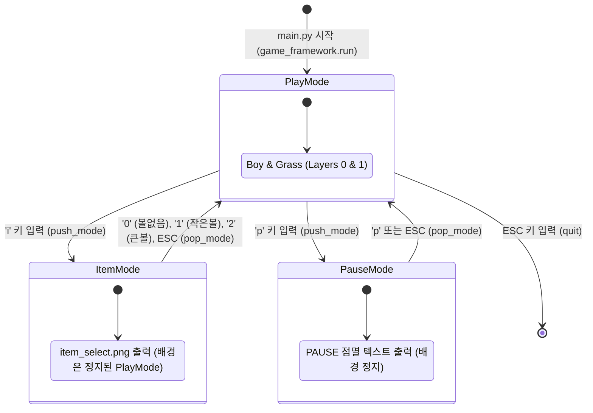

# Drill #13 - 아이템 모드 구현 및 게임 프레임워크 (Item Mode & Game Framework)

2D 게임프로그래밍 과제 - **Drill #13 (아이템 모드 구현 - AI 활용)**  
스택(Stack) 기반 게임 프레임워크(`game_framework.py`)를 활용한 멀티 모드 전환 및 모달 아이템 선택 팝업 구현.

---

## 1. 과제 요구사항 충족 요약

- **아이템 모드 구현 (`item_mode.py`)**:
  - `play_mode` 진행 중 `'i'` 키를 누르면 `game_framework.push_mode(item_mode)`를 호출하여 팝업 실행.
  - 플레이 화면이 일시정지된 상태로 배경에 유지되며, 화면 중앙에 `item_select.png` 다이얼로그 출력.
  - **`0` 키**: **볼없음 (None)** 선택 후 `pop_mode()`로 복귀 (스페이스바를 눌러도 공 발사 안 됨).
  - **`1` 키**: **작은볼 (`ball21x21.png`)** 선택 후 `pop_mode()`로 복귀 (스페이스바 입력 시 작은 공 발사).
  - **`2` 키**: **큰볼 (`ball41x41.png`)** 선택 후 `pop_mode()`로 복귀 (스페이스바 입력 시 큰 공 발사).
  - **`ESC` 키**: 변경 없이 플레이 화면으로 복귀 (`pop_mode()`).
- **추가 편의 기능 (`pause_mode.py`)**:
  - `'p'` 키 입력 시 게임 화면이 정지되고 화면 중앙에 `PAUSE` 텍스트가 점멸.
  - 다시 `'p'` 키 또는 `ESC` 키 입력 시 즉시 게임 재개.
- **깃 커밋 로그 관리**:
  - 프레임워크 설계, 기본 플레이 모드, 다이나믹 볼 시스템, 아이템 모드, 일시정지 모드 등 개발 과정에 맞추어 **충분하고 적절한 단위 커밋 로그**를 작성.

---

## 2. 모드 아키텍처 (Mode Stack Architecture)

---

## 3. 키 조작 일람표 (Key Controls)

| 모드 (Mode) | 키 입력 (Key) | 동작 설명 (Description) |
| :--- | :--- | :--- |
| **Play Mode** | `◀` / `▶` 방향키 | 소년 캐릭터 좌우 이동 |
| **Play Mode** | `SPACE` | 현재 장착된 볼 발사 (수면 상태 시 기상) |
| **Play Mode** | `i` | **아이템 선택 모드 진입 (`push_mode`)** |
| **Play Mode** | `p` | 게임 일시정지 모드 진입 (`push_mode`) |
| **Play Mode** | `ESC` | 게임 종료 |
| **Item Mode** | `0` | **볼없음 (None)** 선택 및 복귀 (`pop_mode`) |
| **Item Mode** | `1` | **작은볼 (`ball21x21.png`)** 선택 및 복귀 (`pop_mode`) |
| **Item Mode** | `2` | **큰볼 (`ball41x41.png`)** 선택 및 복귀 (`pop_mode`) |
| **Item Mode** | `ESC` | 선택 취소 및 플레이 복귀 (`pop_mode`) |
| **Pause Mode** | `p` / `ESC` | 일시정지 해제 및 플레이 복귀 (`pop_mode`) |

---

## 4. 파일 구성

- **`main.py`**: 프로그램 진입점 (`game_framework.run(play_mode)`).
- **`game_framework.py`**: 스택 기반 모드 라이프사이클 관리 (`run`, `change_mode`, `push_mode`, `pop_mode`, `quit`).
- **`game_world.py`**: 다중 레이어 게임 오브젝트 관리자 (`add_object`, `remove_object`, `update`, `render`).
- **`play_mode.py`**: 소년, 잔디, 볼 오브젝트가 동작하는 메인 플레이 모드.
- **`item_mode.py`**: 0, 1, 2 키를 통해 볼 타입을 동적으로 선택하는 모달 팝업 모드.
- **`pause_mode.py`**: 화면을 일시정지하고 PAUSE 텍스트를 깜빡이는 일시정지 모드.
- **`boy.py`**: FSM 기반 상태 머신(IDLE, SLEEP, RUN) 및 아이템별 볼 발사(`fire_ball`).
- **`ball.py`**: `Ball` (21x21) 및 `BigBall` (41x41) 구현.
- **`grass.py`**: 지형 렌더링.
- **`logo_mode.py` / `title_mode.py`**: 씬 전환 확장 모드.
- **`run.bat`**: 원클릭 게임 실행 배치 스크립트.
- **`push.bat`**: GitHub 원격 저장소 푸시 헬퍼 스크립트.
